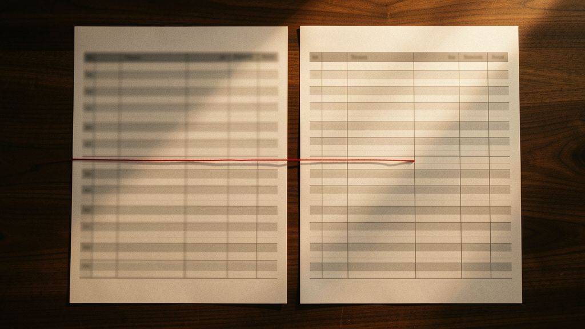

*Caption: Every document passed review. The set was wrong — and nobody was holding the magnifying glass.*

I run a small fleet of AI coding agents for a living. Last month I did something boring: I audited ten documents that fleet had produced for a single project. Cost estimates, quota plans, a migration brief, a couple of internal runbooks. Three parallel agents had written them, with a model switch mid-run when one provider started throttling us.

Every document was fine. Readable, well structured, plausible numbers, confident recommendations. If any one of them had crossed my desk, I would have approved it.

The set was wrong. One document put our build-minutes allowance at 50 included and 200 charged. Another said 60 and 300, for the same plan, in the same quarter. A margins section claimed roughly 84 percent headroom on the same workload where a different document claimed roughly 96. Two documents computed break-even for identical assumptions and disagreed by about a third. Nobody caught any of this for two weeks. Including me.

Part of this was my fault, and it matters to say which part. The model switch was unpinned; the numbers were regenerated per document instead of referenced from one source. Three human consultants recomputing the same quota per chapter would give you the same corpus, minus the speed. What the agents changed was not the failure mode but the rate, and nothing in my process was built to notice: two weeks of contradictions, invisible, because everything I had for catching wrongness was aimed at individual artifacts.

Nothing looked wrong. That was the problem.

## Writing became free. Verifying became the job

When the agents arrived, my costs didn't drop. They moved.

I used to spend my day writing code and a sliver of it reviewing other people's. Now I spend my day reviewing output from something that writes infinitely fast and is occasionally, untraceably confident. Review was always the seniors' work; what changed is the volume. The job quietly became mentoring a junior who never sleeps, never gets embarrassed, and is always almost right.

The industry data rhymes with my calendar. DORA 2025 (Google's report; n≈5,000) found 90 percent of respondents using AI at work, more than 80 percent believing it made them productive, adoption associated with higher throughput and product performance, and still with lower delivery stability. More software, less settled software. DORA's own summary: AI doesn't fix a team; it amplifies what's already there. My reading of that, and it is my reading: if your review capacity was the weak link, it is now the loud one.

Review is the least scalable practice we have, and it is where the volume lands. One preprint, tracking 278,790 review conversations across 300 open-source projects, found reviewers go through 11.8 percent more rounds on AI-generated code than on human-written code. A second preprint, covering 16 automated AI review tools and 22,000-plus comments, found 60 percent of reviewer-coded valid human comments led to actual code changes, against 0.9 to 19.2 percent for valid AI comments. Neither is peer-reviewed yet. Together they sketch an ugly pattern: we grind harder on each AI diff and believe less of what any reviewer says. Per-diff scrutiny is up. Per-set auditing barely exists. That is how total cost can rise while every task feels faster: generation got cheap, verification didn't, and the auditing nobody has time for quietly falls off the end of the queue.

*Caption: Generation scales with the fleet. Verification still runs at one desk.*

## Consistency drift

Here is the failure mode I found in those ten documents, and the name I've given it: consistency drift. Each artifact is individually plausible. The corpus contradicts itself.

The mode is old and so are the fixes. Requirements traceability, configuration management, and single-sourced publishing exist precisely to stop corpora contradicting themselves; aerospace shops review the set as a formal objective, and DITA made reference-over-regeneration a standard in 2005. Researchers measuring model behavior document the raw material directly, under names like self-inconsistency and self-contradiction. I'm not claiming discovery. What changed is scale and speed: fleet-volume generation produces contradictions faster than human-speed discipline ever had to handle, and most teams never had the formal discipline at all.

It slips through every human gate we have, because every human gate is per-artifact. Code review examines one diff. A reader reads one document. Correctness, in practice, gets treated as a property of each piece. But with generated output, correctness is also a property of the set, and no human ever sees the set. My quota contradiction lived in the gap between document three and document seven. Both documents were excellent.

*Caption: Same quota, same quarter, two documents — 50/200 in one, 60/300 in the other.*

Machine gates are different, where they exist. Type checkers cross modules, CI runs repo-wide, and package resolvers compare declared dependencies against reality, which a USENIX Security 2025 paper shows matters: across 440,445 generated code samples, 19.7 percent contained at least one hallucinated package import, 205,474 unique fake names. Only 13.4 percent were near-miss typos; the rest were simply names for libraries that do not exist. The resolver catches those at install time, which is why attackers now register some of them, a practice called slopsquatting: the gate works well enough to be worth attacking. Prose has no resolver. A fluent number in a document meets no check at all. A Microsoft and Carnegie Mellon participant described it from the inside: as you keep interacting with the AI, inconsistencies "evolve and amplify."

Veracode, a security vendor, ran 100-plus models through security tests and reported 45 percent of generated samples failed. There's no clean human baseline in that figure, so don't read it as a rate comparison. The lesson is the same from another angle: code that compiles, passes its tests, and reads cleanly is still not code you can trust, and none of those checks compare artifacts to each other.

That is the real shape of the damage. The obvious mistakes get caught because they look like mistakes. Consistency drift is the medium-plausible at scale, and it sails through, because our human quality culture inspects items, not sets.

## The skill that decays is distrusting in time

The standard take is that juniors won't learn to code. Maybe. I watch something worse in seniors, including myself.

A model proposes an architecture that reads beautifully and references patterns I respect. I adopt it, and if you asked me to re-derive the tradeoffs from first principles, the honest answer lately is that I stopped doing that somewhere around the hundredth good-enough suggestion. The Microsoft and Carnegie Mellon survey (319 knowledge workers, self-reported, cross-sectional) found higher confidence in GenAI associated with less enacted critical thinking. The study made no seniority split; the observation about seniors is mine.

The Stack Overflow 2025 survey puts numbers on the mood: 46 percent of developers distrust the accuracy of AI output, against roughly a third who trust it, and only about 3 percent highly trust it. The most experienced developers are the most suspicious. We know. We keep using it anyway, because suspicion that never fires is indistinguishable from trust.

Pilots lived a version of this thirty years before us. "Children of the magenta" comes from a 1997 American Airlines video about crews who fly the magenta line, monitoring the automation instead of the airplane. After Asiana 214, the NTSB wrote that "without greater opportunity for pilots to manually fly the airplane, their airplane handling skills degrade." Airlines and regulators answered with recurrent simulator checks and deliberate manual flying time. Not because automation is bad. Because the skill that decays under reliable automation is intervening in time, and it decays in captains, not just cadets.

*Caption: The magenta line is steady. The hands that could take over are asleep.*

My version of the magenta line is approving the third well-written artifact of the morning without re-deriving it. The skill that atrophies is not writing code. It is distrusting at the right moment. I now spend more of my day deciding whether to believe something than how to build something, and those trust decisions arrive disguised as technical decisions.

## Where AI is honestly net-positive

This is not an anti-AI essay, and receipts cut both ways.

For mechanical work with machine-checkable success criteria, the fleet earns its keep. Boilerplate. Mechanical migrations, the kind where a compiler tells you when you're done. Documentation for stable APIs. Test scaffolding, where the claims are falsifiable by running them. Meta's self-published numbers on its TestGen-LLM system, run on Meta's own mature codebases: 75 percent of generated test cases built, 57 percent passed reliably, meaning 43 percent didn't, and engineers accepted 73 percent of the filtered candidates during test-a-thons. Those are mediocre numbers, and that is the point. The work is verified by something cheaper than a human's attention, so even a mediocre colleague passes review cheaply.

Look at what those cases share: the output can be checked by a compiler, a test run, a coverage delta. Where plausibility is the only signal, drift wins. Where a machine can check the work, the agent is a multiplier. I have stopped feeling guilty about the difference and started routing work accordingly.

## What I changed

None of this is invention. It is configuration management and single-sourced publishing, fields that solved cross-artifact consistency decades ago, now adopted at fleet speed. Four habits, all cheap:

1. **A set-level pass.** After the fleet finishes a batch, every number across all artifacts goes into one sheet, and I diff it. Cross-document contradictions are defects, with an owner and a fix. This is detection. It does not scale, and it is not supposed to live forever.
2. **One model per artifact set.** Model switches are recorded events, because they are the moment the priors change. If a switch happens, the numbers sheet gets rebuilt.
3. **Numbers live in one source of truth.** Agents cite the value; they don't compute it. A number in two documents got there by reference, never by regeneration. This is prevention, and every number it absorbs is a row habit 1 stops needing.
4. **One re-derivation per week.** I pick an adopted architecture decision and redo the reasoning by hand, no assistant. My manual flying hours, unaudited self-report and all. It costs an hour and it is the only thing keeping the distrust reflex alive.

## The defaults were the product

I expected AI to degrade my code. Instead it degraded my defaults: habits that were never guarantees, only conveniences of slow authorship. Review scales with authorship. Correctness is a property of the artifact in front of me. Bad output looks bad.

They worked when writing was slow and expensive: slow authorship kept volume inside review capacity, and the person who wrote the thing was the person who understood it. Generation at fleet speed broke the correlation quietly, and my old triggers never fired, because nothing I was looking at ever looked wrong.

The teams that come out of this decade intact will not be the ones generating the most code. They will be the ones who can still tell, at the scale of a corpus rather than a diff, when the whole set is lying to them politely.

I check the numbers sheet twice now. It is the least glamorous engineering I do. Most of its rows are dying by design, deleted by the source of truth, and the remainder is the one part of my day that faces the fleet's speed instead of drowning in it.
