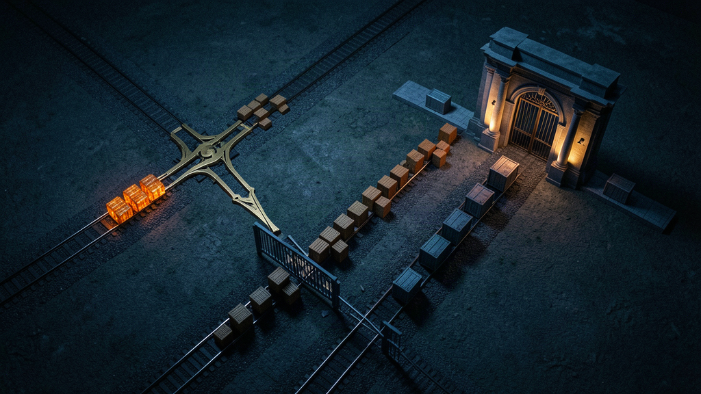

At Ignite in San Francisco on November 17, Mustafa Suleyman made the case for a cheaper model with a sentence vendors normally keep in internal decks: "When the same model is built to also push the frontier of science, you pay for that capability on every task, even for a routine bug fix."

Read that twice. The CEO of Microsoft AI, on stage, selling a product, said the quiet part out loud: frontier capability is overhead on routine work. Companies do not usually announce cheaper models by explaining what those models cannot do. Microsoft did. The launch post for MAI Code 2 states the new models are "explicitly not yet tuned for harder problems, like fundamental science research and very long-horizon agentic work."

Quality did not degrade. It got a price list.

*The number everyone quoted is the headline. The number that matters is the footnote.*

## The claim that traveled, and the footnote that did not

Here is the number the coverage carried: MAI Code 2 delivers 96% of Claude Opus 5.5's coding performance at 5% of the cost. Here is what the footnote says. Both figures are Microsoft's own, produced on MSBench, which the company describes as "Microsoft's internal eval platform." The suite averages DeepSWE 1.1, Terminal-Bench 2.1, and SWE-Atlas, all run by Microsoft on its own Copilot CLI harness with subagents disabled, plus FrontierCode v1.1 imported from Artificial Analysis. The model card is explicit about the protocol: "mean single-attempt pass rate, not pass@k." Three runs per task.

The 96% falls out of their table as 63.2 against 65.3. Fine. The cost side is where the asterisk earns its keep: the 5% is computed at Code 2's promotional price, $0.309 against $6.306 per task. Input at $0.50 per million tokens, output at $2.50, half the list price that takes effect May 17, 2027. Opus 5.5 lists at $4 and $20.

At list price the story is still cheap, just less headline-friendly. Per token, Code 2 lands at a quarter of Opus. Per task on their own bench, about a tenth, 9.8%. A tenth at list, a twentieth at promo. The discount is doing half the work in the number everyone quoted.

I have written before about what a registration statement does to a number. Under Section 11 liability, a company heading to market has to defend every material figure it prints. A product launch has no such discipline, and to be fair, Microsoft did not need it here: every caveat in this paragraph sits in the company's own footnotes. The vendor disclosed. The coverage stripped. Still, know what the sentence is made of: a vendor-run average, on a promotional price, with both models pinned at maximum reasoning effort, the setting where Opus burns the most tokens, from the company selling the cheaper tier. Every clause is load-bearing.

## Where the 4% lives

The average is the least interesting number on the page. The spread is the story. Against Opus, Code 2 wins DeepSWE 1.1 outright, 73.2 to 69.0, and posts the best score of the three models compared on Terminal-Bench 2.1, 84.6 to 78.7. It sits 4.0 points behind on FrontierCode. And on SWE-Atlas it falls 14.4 points back, the one suite built around whole-repo reasoning, QA and refactoring. The 96% is an average of two wins, a near-draw, and a collapse.

That distribution is the product. The commodity tier does not deliver 96% of frontier performance everywhere. It delivers full performance and better on a large class of routine work, then falls away hardest where tasks scale across a whole repository. Microsoft's own line, "explicitly not yet tuned for harder problems, like fundamental science research and very long-horizon agentic work," points in that direction even if the suite-level map is messier than a keynote slide. One honesty note cuts both ways: three runs per task, no variance published. Treat single-digit margins, mine included, as suggestive.

And the bull case deserves its own paragraph, because it is real. Against GPT-6.1 Sol, the same table shows Code 2 at 98% of the performance for 40% of the cost. Early hands-on in the launch thread reads like this: one engineer fixed a Python build under WSL and a Bicep deployment in a single sitting, then wrote "Didn't feel the difference from Claude Opus." A model you cannot distinguish from the frontier on everyday work, with a context window around 1.05 million tokens, at a tenth of the per-task price, is a genuine event for anyone paying the invoice. "Explicitly not yet tuned for harder problems" is not a lawyer's disclaimer bolted to the bottom of the page. It is the specification. The honesty is the positioning.

If you run a fleet of agents, this is the useful shape of the launch. The routine bulk of coding work, the boilerplate, the mechanical migrations, the test scaffolding, just got a credible price tag an order of magnitude below frontier. The hard fifth, the long chains where a wrong step compounds, still wants the expensive model. Nothing about your job got simpler. Your cost model did.

*Against Opus across four suites: +4.2, +5.9, −4.0, −14.4. The 96% averages two wins, a near-draw, and a collapse.*

## They are also selling the thing that picks

Tiering the models is half the strategy. The other half is routing. Alongside Code 2, Microsoft positions Decision 1.1, a router that assigns each task to a tier, "so that the bigger, pricier models are only used when you really need them."

Project that forward. The most consequential decision in your stack, which grade of intelligence looks at this task, stops being an engineering decision and becomes a vendor product. The router lives in their platform, sees your traffic, and encodes the policy. You can overrule it, the way you can overrule a code generator, and the pattern with enabled-by-default model rollouts says most people, most of the time, will not.

I wrote a piece called "AI Didn't Degrade My Code. It Degraded My Defaults." about the reflexes that erode when generation becomes free. Routing is those defaults, externalized. First you stop writing the code, then you stop choosing what reviews it, and eventually the judgment about which tier of attention a problem deserves is a subscription feature. The skill that decays is knowing the difference before the invoice tells you.

*The vendor owns the switch point that decides which lane your task takes.*

## The leash attached to the discount

The cheap tier arrives tied to the platform. The license is closed; the model card is blunt that "model weights are not distributed," with weights in your tenant available only through an engagement. At launch there is no standalone API: Code 2 ships inside GitHub Copilot on usage-based billing, the smaller Code 2 Flash appears in a limited Foundry preview, and the third-party listings, OpenRouter, Vercel, the agent harnesses, are marked "soon" with no dates. Under the hood sits MAI-Base-2, pretrained and post-trained by Microsoft from scratch between August and November, with a context window around 1.05 million tokens. (The model card disagrees with itself about parameter counts, which is a fair calibration for how much launch-week documentation to trust.)

So the trade is explicit. Microsoft commoditized the model and kept the distribution. You get frontier-adjacent routine work at a twentieth of the price, and in exchange the routing, the billing, and the model itself live inside walls you do not hold keys to. Goldman gating Claude Code desk by desk, as documented in the prospectus piece, was a policy question. This is the same question shipping as a product.

## What the thread got right

The Hacker News discussion ran to 421 points and 171 comments, and the argument settled into three useful grooves. The moat crowd argued that pricing the routine tier this aggressively pulls the floor out from under model-only vendors. The enterprise crowd ran the cost-switching math, and it favors Microsoft the moment your usage is heavy and routine. And the skeptics landed the punch much of the coverage missed, within 48 hours: the headline cost is the promotional one, the comparison runs with both models at maximum effort, on the vendor's own harness. Credit where due, that catch was the thread's, and it matches this piece's footnote audit. All three positions can be true at once. That is usually a sign the launch was designed well.

The complaint that will genuinely slow adoption got less airtime. Anyone on Copilot can buy Code 2 today on usage-based billing, and the Flash variant reaches a Foundry preview. What does not exist yet is a standalone API for the big model, and practitioners who build their own harnesses do not route Copilot SKUs into them. Until the API and the third-party listings land, this is a Copilot story before it is a model story, and the teams best positioned to exploit a cheap routine tier are largely the ones waiting outside the gate.

*Twentieth-of-price routine work, inside walls whose keys stay with the vendor.*

## The buyer's math

Put launch week in one frame. On Tuesday, Microsoft prices the routine tier explicitly and sells the router that moves work between tiers. On Wednesday, Anthropic prices its IPO at a $1.5 trillion valuation while its filing refuses to price the agent layer at all, disclosing a usage proxy instead of a revenue line. Two of the largest vendors in the field, converging on the same admission from opposite ends. The economics of generated code now live in the tiers and the routing, not in the tokens.

For a buyer, the leverage is knowing your own task distribution. If your work is 90% routine, the promo pricing is close to free and you should be rebuilding your cost model around it. If your work is long-horizon and compounding, the 14.4-point gap on SWE-Atlas is the number that matters and the 5% is a decoy. Most teams are a mix, which means the expensive question is the one in the middle: what fraction of your tasks are secretly long-horizon, disguised as routine by how you currently write tickets?

That is the tier question, asked about your own backlog instead of a model card. Microsoft just put a price on the routine. The frontier is still the frontier. The part that changed is who decides which one you are holding, and their answer is the router. Yours should be better informed, and at minimum it should be yours.
